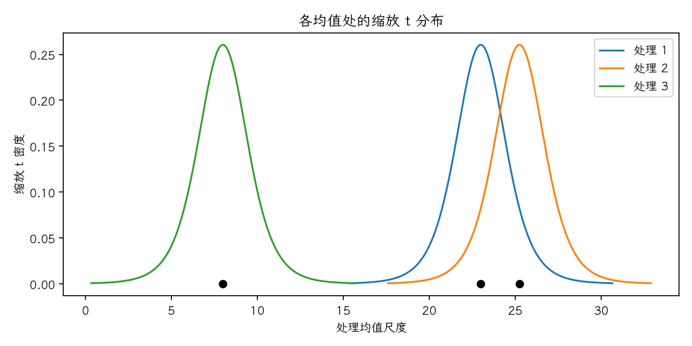

(exercise-4-11)=
# 习题 4.11：处理均值与缩放 t 分布

[习题与答案](../../index.md) / [第 4 章　随机区组、拉丁方与相关设计](../chapter04.md)

第 9 版 · 第 4 章 · 原书章末习题见印刷页 171～178。题目依据第 9 版，参考答案按题意匹配。

## 题目

绘制习题 [4.9](./exercise-4-9.md) 中各处理的样本均值，与适当缩放的 t 分布比较，并解释结论。

| 处理／区组（4.17 为组内受试者序号） | 1 | 2 | 3 | 4 |
| --- | --- | --- | --- | --- |
| 洗涤液1 | 13 | 22 | 18 | 39 |
| 洗涤液2 | 16 | 24 | 17 | 44 |
| 洗涤液3 | 5 | 4 | 1 | 22 |

## 答案与解析

绘制 $m_i+s_{\bar y} t_{6}$ 的密度曲线，其中 $s_{\bar y}=\sqrt{MS_E/b}=1.4696$，$m_i=\bar y_i$。曲线重叠仅作直观参考，正式逐对判断使用 $SE(\bar y_i-\bar y_j)=\sqrt{2MS_E/b}$，不能简单按两条均值区间是否重叠作显著性判断。

估计量为 $\hat\mu_i=\bar y_{i\cdot}$，$\widehat{\mu_i-\mu_j}=\bar y_i-\bar y_j$；$LSD=t_{0.975,6}\sqrt{2MS_E/b}=5.08548$。差值的逐对 95% 区间为估计差 $\pm LSD$。

| 处理 | 样本均值 |
| --- | --- |
| 1 | 23 |
| 2 | 25.25 |
| 3 | 8 |

| 处理对 | 均值差 | 95% 区间 | LSD 判定 |
| --- | --- | --- | --- |
| 1 − 2 | -2.25 | [-7.33548, 2.83548] | 不显著 |
| 1 − 3 | 15 | [9.91452, 20.0855] | 显著 |
| 2 − 3 | 17.25 | [12.1645, 22.3355] | 显著 |

Fisher LSD 为逐对比较，不能将其解释为所有区间联合具有 95% 覆盖率。整体检验不显著时，不以保护性 LSD 宣布处理差异。

---

**答案来源**：按题意对应 `Exercises/ch04.pdf` 的 4.10；公式与数值由编者复核，补充完整推导与诊断。

← [上一题 4.10](./exercise-4-10.md) · [本章题目目录](../chapter04.md) · [下一题 4.12](./exercise-4-12.md) →
