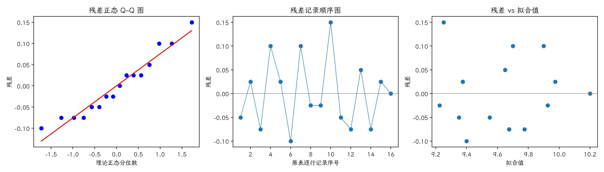

(exercise-4-12)=
# 习题 4.12：压头与硬度读数

[习题与答案](../../index.md) / [第 4 章　随机区组、拉丁方与相关设计](../chapter04.md)

第 9 版 · 第 4 章 · 原书章末习题见印刷页 171～178。题目依据第 9 版，参考答案按题意匹配。

## 题目

硬度试验使用 4 种压头和 4 块试片，以试片为区组。数据为 Rockwell C 标度读数减去 40。

| 处理／区组（4.17 为组内受试者序号） | 1 | 2 | 3 | 4 |
| --- | --- | --- | --- | --- |
| 压头1 | 9.3 | 9.4 | 9.6 | 10 |
| 压头2 | 9.4 | 9.3 | 9.8 | 9.9 |
| 压头3 | 9.2 | 9.4 | 9.5 | 9.7 |
| 压头4 | 9.7 | 9.6 | 10 | 10.2 |

**（a）** 分析试验数据。

**（b）** 用 Fisher LSD 法比较各处理，确定哪些总体均值不同。

**（c）** 分析残差。

## 答案与解析

### （a）方差分析

**模型与假设**：$y_{ij}=\mu+\tau_i+\beta_j+\epsilon_{ij}$，$\sum_i\tau_i=\sum_j\beta_j=0$；误差独立且服从 $N(0,\sigma^2)$，处理与区组效应可加，没有处理×区组交互作用。处理在各区组内随机分配。

**假设与检验**：$H_0:\tau_1=\cdots=\tau_a=0$；$H_1$：至少一个处理效应非零。令 $C=G^2/(ab)$，$T_i$、$B_j$ 分别为处理及区组总和，

$$SS_T=\sum_{ij}y_{ij}^2-C,\quad SS_A=\frac{\sum_iT_i^2}{b}-C,\quad SS_B=\frac{\sum_jB_j^2}{a}-C,$$
$$SS_E=SS_T-SS_A-SS_B,\quad F_0=\frac{SS_A/(a-1)}{SS_E/[(a-1)(b-1)]}\sim F_{a-1,(a-1)(b-1)}\quad(H_0).$$

除题目另有说明，取 $\alpha=0.05$，以 $P<0.05$ 拒绝原假设。本文 $t_q,F_q$ 均指下侧累积概率为 $q$ 的分位数。区组作为控制因素，不将其显著性作为保留区组的前提。

| 来源 | 自由度 | 平方和 | 均方 | $F$ | $P$ 值 |
| --- | --- | --- | --- | --- | --- |
| 区组 | 3 | 0.825 | 0.275 | 30.9375 | 4.52327e-05 |
| 处理（调整后） | 3 | 0.385 | 0.128333 | 14.4375 | 0.000871272 |
| 误差 | 9 | 0.08 | 0.00888889 | — | — |
| 总计 | 15 | 1.29 | — | — | — |

$F_0=14.4375$，$P=0.000871272$，拒绝处理均值相等的原假设，有处理差异的证据。

### （b）Fisher LSD 比较

估计量为 $\hat\mu_i=\bar y_{i\cdot}$，$\widehat{\mu_i-\mu_j}=\bar y_i-\bar y_j$；$LSD=t_{0.975,9}\sqrt{2MS_E/b}=0.15081$。差值的逐对 95% 区间为估计差 $\pm LSD$。

| 处理 | 样本均值 |
| --- | --- |
| 压头1 | 9.575 |
| 压头2 | 9.6 |
| 压头3 | 9.45 |
| 压头4 | 9.875 |

| 处理对 | 均值差 | 95% 区间 | LSD 判定 |
| --- | --- | --- | --- |
| 1 − 2 | -0.025 | [-0.17581, 0.12581] | 不显著 |
| 1 − 3 | 0.125 | [-0.0258105, 0.27581] | 不显著 |
| 1 − 4 | -0.3 | [-0.45081, -0.14919] | 显著 |
| 2 − 3 | 0.15 | [-0.000810478, 0.30081] | 不显著 |
| 2 − 4 | -0.275 | [-0.42581, -0.12419] | 显著 |
| 3 − 4 | -0.425 | [-0.57581, -0.27419] | 显著 |

Fisher LSD 为逐对比较，不能将其解释为所有区间联合具有 95% 覆盖率。整体检验不显著时，不以保护性 LSD 宣布处理差异。

### （c）残差分析

残差为 $e=y-X\hat\theta$。左图检查正态性及极端残差，右图检查方差和均值结构。中图按表中逐行记录顺序绘制；题目未给出实际随机运行顺序，**它不是真实时序图，不能据此确认时间独立性**。需获得运行日志后再按实际时间重画。未见明显图形异常也不能证明假设成立。

残差 Shapiro–Wilk 统计量 $W=0.939575$、$P=0.34384$（作为辅助描述，拟合残差相互相关，不能当成独立原始样本的精确检验）。未检出明显的正态性偏离；小样本下检验功效有限，仍应结合 Q–Q 图判断。

---

**答案来源**：按题意对应 `Exercises/ch04.pdf` 的 4.11；公式与数值由编者复核，补充完整推导与诊断。

← [上一题 4.11](./exercise-4-11.md) · [本章题目目录](../chapter04.md) · [下一题 4.13](./exercise-4-13.md) →
