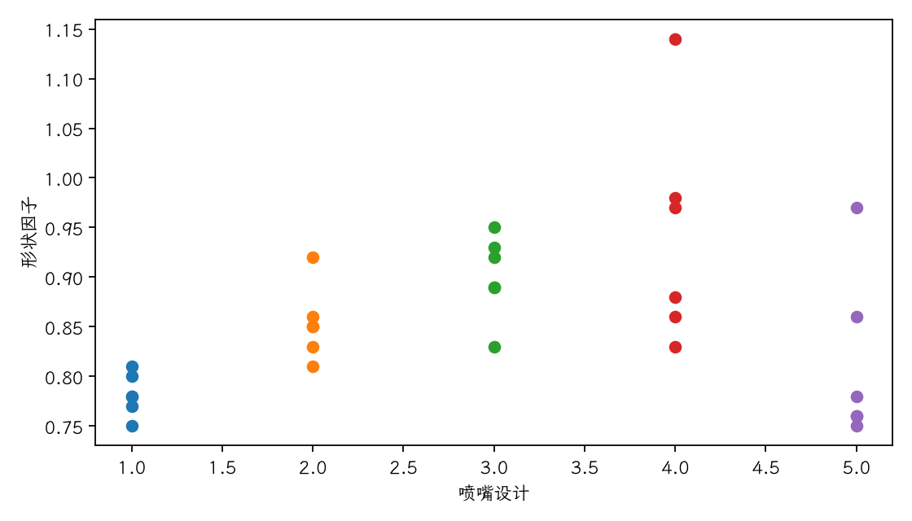
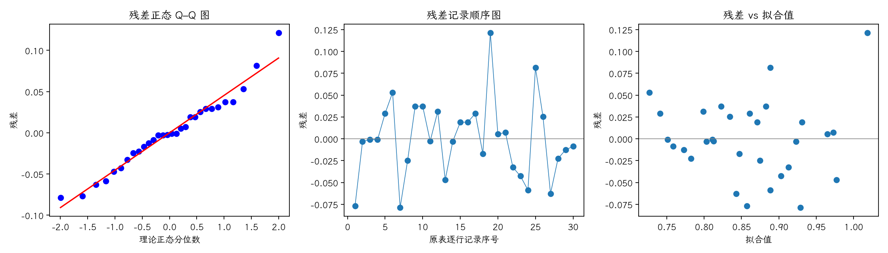
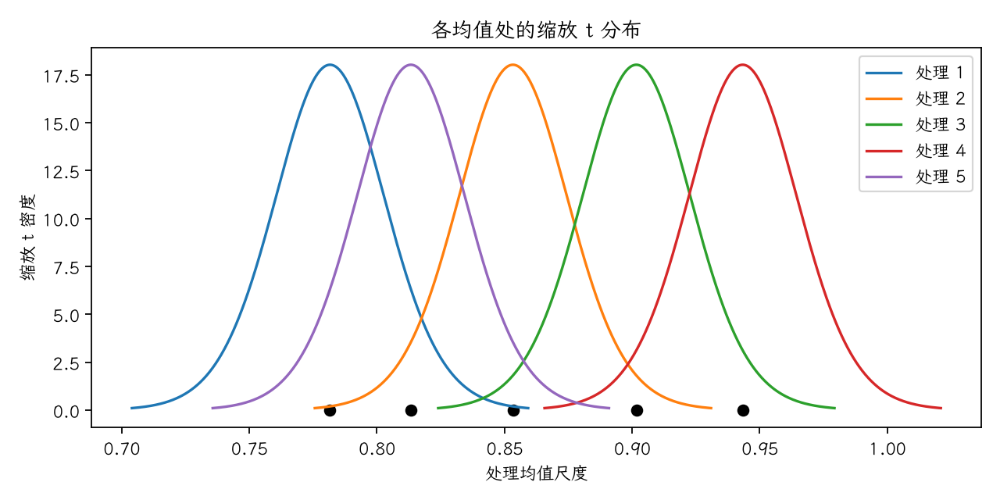

(exercise-4-15)=
# 习题 4.15：喷嘴设计与形状因子

[习题与答案](../../index.md) / [第 4 章　随机区组、拉丁方与相关设计](../chapter04.md)

第 9 版 · 第 4 章 · 原书章末习题见印刷页 171～178。题目依据第 9 版，参考答案按题意匹配。

## 题目

《Fire Safety Journal》（第 4 卷，1981 年 8 月）研究喷嘴设计对湍流水射流稳定性和性能的影响。在出口速度 11.73、14.37、16.59、20.43、23.46、28.74 m/s 下测得形状因子，以速度为干扰因子（区组），比较 5 种喷嘴。

| 处理／区组（4.17 为组内受试者序号） | 1 | 2 | 3 | 4 | 5 | 6 |
| --- | --- | --- | --- | --- | --- | --- |
| 喷嘴1 | 0.78 | 0.8 | 0.81 | 0.75 | 0.77 | 0.78 |
| 喷嘴2 | 0.85 | 0.85 | 0.92 | 0.86 | 0.81 | 0.83 |
| 喷嘴3 | 0.93 | 0.92 | 0.95 | 0.89 | 0.89 | 0.83 |
| 喷嘴4 | 1.14 | 0.97 | 0.98 | 0.88 | 0.86 | 0.83 |
| 喷嘴5 | 0.97 | 0.86 | 0.78 | 0.76 | 0.76 | 0.75 |

**（a）** 用散点图和方差分析判断喷嘴设计是否影响形状因子，取 $\alpha=0.05$。

**（b）** 分析残差。

**（c）** 绘制均值与缩放 t 分布，判断哪些喷嘴有差异，并与 Duncan 多重极差检验比较。

## 答案与解析

### （a）散点图与方差分析

**模型与假设**：$y_{ij}=\mu+\tau_i+\beta_j+\epsilon_{ij}$，$\sum_i\tau_i=\sum_j\beta_j=0$；误差独立且服从 $N(0,\sigma^2)$，处理与区组效应可加，没有处理×区组交互作用。处理在各区组内随机分配。

**假设与检验**：$H_0:\tau_1=\cdots=\tau_a=0$；$H_1$：至少一个处理效应非零。令 $C=G^2/(ab)$，$T_i$、$B_j$ 分别为处理及区组总和，

$$SS_T=\sum_{ij}y_{ij}^2-C,\quad SS_A=\frac{\sum_iT_i^2}{b}-C,\quad SS_B=\frac{\sum_jB_j^2}{a}-C,$$
$$SS_E=SS_T-SS_A-SS_B,\quad F_0=\frac{SS_A/(a-1)}{SS_E/[(a-1)(b-1)]}\sim F_{a-1,(a-1)(b-1)}\quad(H_0).$$

除题目另有说明，取 $\alpha=0.05$，以 $P<0.05$ 拒绝原假设。本文 $t_q,F_q$ 均指下侧累积概率为 $q$ 的分位数。区组作为控制因素，不将其显著性作为保留区组的前提。

| 来源 | 自由度 | 平方和 | 均方 | $F$ | $P$ 值 |
| --- | --- | --- | --- | --- | --- |
| 区组 | 5 | 0.0628667 | 0.0125733 | 4.3886 | 0.00736418 |
| 处理（调整后） | 4 | 0.10218 | 0.025545 | 8.91623 | 0.00026554 |
| 误差 | 20 | 0.0573 | 0.002865 | — | — |
| 总计 | 29 | 0.222347 | — | — | — |

$F_0=8.91623$，$P=0.00026554$，拒绝处理均值相等的原假设，有处理差异的证据。

### （b）残差分析

残差为 $e=y-X\hat\theta$。左图检查正态性及极端残差，右图检查方差和均值结构。中图按表中逐行记录顺序绘制；题目未给出实际随机运行顺序，**它不是真实时序图，不能据此确认时间独立性**。需获得运行日志后再按实际时间重画。未见明显图形异常也不能证明假设成立。

残差 Shapiro–Wilk 统计量 $W=0.969916$、$P=0.536868$（作为辅助描述，拟合残差相互相关，不能当成独立原始样本的精确检验）。未检出明显的正态性偏离；小样本下检验功效有限，仍应结合 Q–Q 图判断。

第 4、5 种喷嘴的响应随速度变化较明显，提示喷嘴×速度交互作用或非恒定变异；单次观测的可加模型不能将交互作用与误差分开，显著性结论须结合这一限制解释。

### （c）处理比较

绘制 $m_i+s_\bar y t_{20}$ 的密度曲线，其中 $s_\bar y=\sqrt{MS_E/b}=0.0218518$，$m_i=\bar y_i$。曲线重叠仅作直观参考，正式逐对判断使用 $SE(\bar y_i-\bar y_j)=\sqrt{2MS_E/b}$，不能简单按两条均值区间是否重叠作显著性判断。

估计量为 $\hat\mu_i=\bar y_{i\cdot}$，$\widehat{\mu_i-\mu_j}=\bar y_i-\bar y_j$；$LSD=t_{0.975,20}\sqrt{2MS_E/b}=0.0644627$。差值的逐对 95% 区间为估计差 $\pm LSD$。

| 处理 | 样本均值 |
| --- | --- |
| 喷嘴1 | 0.781667 |
| 喷嘴2 | 0.853333 |
| 喷嘴3 | 0.901667 |
| 喷嘴4 | 0.943333 |
| 喷嘴5 | 0.813333 |

| 处理对 | 均值差 | 95% 区间 | LSD 判定 |
| --- | --- | --- | --- |
| 1 − 2 | -0.0716667 | [-0.136129, -0.00720398] | 显著 |
| 1 − 3 | -0.12 | [-0.184463, -0.0555373] | 显著 |
| 1 − 4 | -0.161667 | [-0.226129, -0.097204] | 显著 |
| 1 − 5 | -0.0316667 | [-0.0961294, 0.032796] | 不显著 |
| 2 − 3 | -0.0483333 | [-0.112796, 0.0161294] | 不显著 |
| 2 − 4 | -0.09 | [-0.154463, -0.0255373] | 显著 |
| 2 − 5 | 0.04 | [-0.0244627, 0.104463] | 不显著 |
| 3 − 4 | -0.0416667 | [-0.106129, 0.022796] | 不显著 |
| 3 − 5 | 0.0883333 | [0.0238706, 0.152796] | 显著 |
| 4 − 5 | 0.13 | [0.0655373, 0.194463] | 显著 |

Fisher LSD 为逐对比较，不能将其解释为所有区间联合具有 95% 覆盖率。整体检验不显著时，不以保护性 LSD 宣布处理差异。

Duncan 法对排序均值中跨度为 $p$ 的一对，采用 $\alpha_p=1-(1-0.05)^{p-1}$，$R_p=q_{1-\alpha_p;p,\nu}\sqrt{MS_E/b}$，按逐步极差程序比较。

| 喷嘴对 | 跨度 p | 均值差 | 临界极差 | 比较 |
| --- | --- | --- | --- | --- |
| 1 与 5 | 2 | 0.0316667 | 0.0644627 | 不显著 |
| 1 与 2 | 3 | 0.0716667 | 0.0676642 | 显著 |
| 1 与 3 | 4 | 0.12 | 0.0696988 | 显著 |
| 1 与 4 | 5 | 0.161667 | 0.0711198 | 显著 |
| 5 与 2 | 2 | 0.04 | 0.0644627 | 不显著 |
| 5 与 3 | 3 | 0.0883333 | 0.0676642 | 显著 |
| 5 与 4 | 4 | 0.13 | 0.0696988 | 显著 |
| 2 与 3 | 2 | 0.0483333 | 0.0644627 | 不显著 |
| 2 与 4 | 3 | 0.09 | 0.0676642 | 显著 |
| 3 与 4 | 2 | 0.0416667 | 0.0644627 | 不显著 |

本题 Duncan 与保护性 LSD 的逐对判定一致：1–2、1–3、1–4、2–4、3–5、4–5 显著，其余处理对不显著。一般情况下两法可能不同；Duncan 不控制全部逐对比较的家族错误率。图中的 t 曲线只是直观展示，应按各方法自身临界值判断。

---

**答案来源**：参考答案无直接对应题；由编者补充推导、计算及诊断。

← [上一题 4.14](./exercise-4-14.md) · [本章题目目录](../chapter04.md) · [下一题 4.16](./exercise-4-16.md) →
