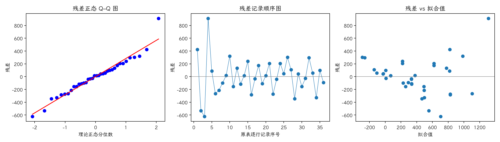

(exercise-4-16)=
# 习题 4.16：软件成本估计算法

[习题与答案](../../index.md) / [第 4 章　随机区组、拉丁方与相关设计](../chapter04.md)

第 9 版 · 第 4 章 · 原书章末习题见印刷页 171～178。题目依据第 9 版，参考答案按题意匹配。

## 题目

《Communications of the ACM》（30 卷 5 期，1987 年）比较 6 种软件开发成本估计算法。对 6 个项目应用全部算法，响应为成本估计的百分误差，以项目为区组。教材第 4 行印作 COCONO-C，这里按通常名称标为 COCOMO-C。

| 处理／区组（4.17 为组内受试者序号） | 1 | 2 | 3 | 4 | 5 | 6 |
| --- | --- | --- | --- | --- | --- | --- |
| SLIM | 1244 | 21 | 82 | 2221 | 905 | 839 |
| COCOMO-A | 281 | 129 | 396 | 1306 | 336 | 910 |
| COCOMO-R | 220 | 84 | 458 | 543 | 300 | 794 |
| COCOMO-C | 225 | 83 | 425 | 552 | 291 | 826 |
| FUNCTION POINTS | 19 | 11 | -34 | 121 | 15 | 103 |
| ESTIMALS | -20 | 35 | -53 | 170 | 104 | 199 |

**（a）** 算法的平均成本估计准确性是否不同？

**（b）** 分析残差。

**（c）** 实际中推荐哪种算法？

## 答案与解析

### （a）方差分析

**模型与假设**：$y_{ij}=\mu+\tau_i+\beta_j+\epsilon_{ij}$，$\sum_i\tau_i=\sum_j\beta_j=0$；误差独立且服从 $N(0,\sigma^2)$，处理与区组效应可加，没有处理×区组交互作用。处理在各区组内随机分配。

**假设与检验**：$H_0:\tau_1=\cdots=\tau_a=0$；$H_1$：至少一个处理效应非零。令 $C=G^2/(ab)$，$T_i$、$B_j$ 分别为处理及区组总和，

$$SS_T=\sum_{ij}y_{ij}^2-C,\quad SS_A=\frac{\sum_iT_i^2}{b}-C,\quad SS_B=\frac{\sum_jB_j^2}{a}-C,$$
$$SS_E=SS_T-SS_A-SS_B,\quad F_0=\frac{SS_A/(a-1)}{SS_E/[(a-1)(b-1)]}\sim F_{a-1,(a-1)(b-1)}\quad(H_0).$$

除题目另有说明，取 $\alpha=0.05$，以 $P<0.05$ 拒绝原假设。本文 $t_q,F_q$ 均指下侧累积概率为 $q$ 的分位数。区组作为控制因素，不将其显著性作为保留区组的前提。

| 来源 | 自由度 | 平方和 | 均方 | $F$ | $P$ 值 |
| --- | --- | --- | --- | --- | --- |
| 区组 | 5 | 2.28734e+06 | 457468 | 4.11455 | 0.00729526 |
| 处理（调整后） | 5 | 2.98913e+06 | 597826 | 5.37696 | 0.00172011 |
| 误差 | 25 | 2.77957e+06 | 111183 | — | — |
| 总计 | 35 | 8.05604e+06 | — | — | — |

$F_0=5.37696$，$P=0.00172011$，拒绝处理均值相等的原假设，有处理差异的证据。

### （b）残差分析

残差为 $e=y-X\hat\theta$。左图检查正态性及极端残差，右图检查方差和均值结构。中图按表中逐行记录顺序绘制；题目未给出实际随机运行顺序，**它不是真实时序图，不能据此确认时间独立性**。需获得运行日志后再按实际时间重画。未见明显图形异常也不能证明假设成立。

残差 Shapiro–Wilk 统计量 $W=0.961395$、$P=0.237285$（作为辅助描述，拟合残差相互相关，不能当成独立原始样本的精确检验）。未检出明显的正态性偏离；小样本下检验功效有限，仍应结合 Q–Q 图判断。

SLIM 在个别项目上的巨大误差导致重尾及不均匀变异。原始尺度的正态同方差模型值得怀疑；存在负数，不能直接对全部误差取对数。

### （c）推荐算法

| 处理 | 样本均值 |
| --- | --- |
| SLIM | 885.333 |
| COCOMO-A | 559.667 |
| COCOMO-R | 399.833 |
| COCOMO-C | 400.333 |
| FUNCTION POINTS | 39.1667 |
| ESTIMALS | 72.5 |

准确性应结合接近零的误差和误差离散度评估，不能仅追求最小的有符号均值。FUNCTION POINTS 的绝对百分误差均值为 50.5，ESTIMALS 为 96.8333；本组项目上优先考虑 FUNCTION POINTS，再以新项目验证。

---

**答案来源**：按题意对应 `Exercises/ch04.pdf` 的 4.14；公式与数值由编者复核，补充完整推导与诊断。

← [上一题 4.15](./exercise-4-15.md) · [本章题目目录](../chapter04.md) · [下一题 4.17](./exercise-4-17.md) →
