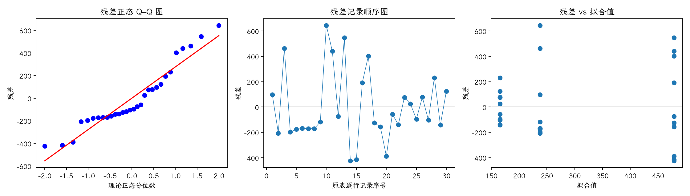
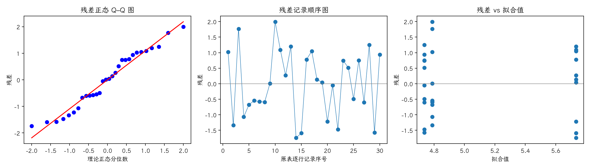

(exercise-4-17)=
# 习题 4.17：白血病治疗与基因表达

[习题与答案](../../index.md) / [第 4 章　随机区组、拉丁方与相关设计](../chapter04.md)

第 9 版 · 第 4 章 · 原书章末习题见印刷页 171～178。题目依据第 9 版，参考答案按题意匹配。

## 题目

《Nature Genetics》（34 卷，2003 年，85～90 页）研究白血病治疗与基因表达。3 个组各含 10 名受试者：仅 MP、MP＋高剂量甲氨蝶呤（HDMTX）、MP＋低剂量甲氨蝶呤（LDMTX）。表中列出某基因的响应。

| 处理／区组（4.17 为组内受试者序号） | 1 | 2 | 3 | 4 | 5 | 6 | 7 | 8 | 9 | 10 |
| --- | --- | --- | --- | --- | --- | --- | --- | --- | --- | --- |
| MP | 334.5 | 31.6 | 701 | 41.2 | 61.2 | 69.6 | 67.5 | 66.6 | 120.7 | 881.9 |
| MP＋HDMTX | 919.4 | 404.2 | 1024.8 | 54.1 | 62.8 | 671.6 | 882.1 | 354.2 | 321.9 | 91.1 |
| MP＋LDMTX | 108.4 | 26.1 | 240.8 | 191.1 | 69.7 | 242.8 | 62.7 | 396.9 | 23.6 | 290.4 |

**（a）** 有证据认为治疗均值不同吗？

**（b）** 检查正态假设，能否认为来自正态总体？

**（c）** 对原数据取对数，重新检验治疗均值。

**（d）** 分析变换后残差并评价模型。

## 答案与解析

### （a）原始尺度分析

原题各组为不同受试者，未说明跨组配对，因此采用独立组单因子模型，不把表中同列序号当作区组。

**模型与假设**：$y_{ij}=\mu+\tau_i+\epsilon_{ij}$，误差独立且服从 $N(0,\sigma^2)$。$H_0$：各处理均值相等；备择为至少一个不同。

$$SS_A=\sum_i n_i(\bar y_i-\bar y)^2,\quad SS_E=\sum_{ij}(y_{ij}-\bar y_i)^2,\quad SS_T=SS_A+SS_E,\quad F_0=\frac{SS_A/(a-1)}{SS_E/(N-a)}.$$

| 来源 | 自由度 | 平方和 | 均方 | $F$ | $P$ 值 |
| --- | --- | --- | --- | --- | --- |
| 处理 | 2 | 538442 | 269221 | 3.24947 | 0.0543867 |
| 误差 | 27 | 2.23697e+06 | 82850.9 | — | — |
| 总计 | 29 | 2.77542e+06 | — | — | — |

$F_0=3.24947$，$P=0.0543867$，不拒绝处理均值相等的原假设；尚无充分证据认定处理均值不同。

### （b）原始尺度正态性

残差为 $e=y-X\hat\theta$。左图检查正态性及极端残差，右图检查方差和均值结构。中图按表中逐行记录顺序绘制；题目未给出实际随机运行顺序，**它不是真实时序图，不能据此确认时间独立性**。需获得运行日志后再按实际时间重画。未见明显图形异常也不能证明假设成立。

残差 Shapiro–Wilk 统计量 $W=0.916539$、$P=0.0218325$（作为辅助描述，拟合残差相互相关，不能当成独立原始样本的精确检验）。正态性检验提示残差偏离正态，应结合 Q–Q 图中的尾部和异常值谨慎解释 F 检验。

原始数据明显右偏，包含较大极值，正态近似值得怀疑；不能由正态性检验未显著推断总体必然正态。

### （c）自然对数尺度分析

所有观测为正，令 $z=\ln y$。

**模型与假设**：$y_{ij}=\mu+\tau_i+\epsilon_{ij}$，误差独立且服从 $N(0,\sigma^2)$。$H_0$：各处理均值相等；备择为至少一个不同。

$$SS_A=\sum_i n_i(\bar y_i-\bar y)^2,\quad SS_E=\sum_{ij}(y_{ij}-\bar y_i)^2,\quad SS_T=SS_A+SS_E,\quad F_0=\frac{SS_A/(a-1)}{SS_E/(N-a)}.$$

| 来源 | 自由度 | 平方和 | 均方 | $F$ | $P$ 值 |
| --- | --- | --- | --- | --- | --- |
| 处理 | 2 | 6.29704 | 3.14852 | 2.57072 | 0.0950671 |
| 误差 | 27 | 33.0686 | 1.22476 | — | — |
| 总计 | 29 | 39.3657 | — | — | — |

$F_0=2.57072$，$P=0.0950671$，不拒绝处理均值相等的原假设；尚无充分证据认定处理均值不同。

### （d）变换后诊断

残差为 $e=y-X\hat\theta$。左图检查正态性及极端残差，右图检查方差和均值结构。中图按表中逐行记录顺序绘制；题目未给出实际随机运行顺序，**它不是真实时序图，不能据此确认时间独立性**。需获得运行日志后再按实际时间重画。未见明显图形异常也不能证明假设成立。

残差 Shapiro–Wilk 统计量 $W=0.956475$、$P=0.251076$（作为辅助描述，拟合残差相互相关，不能当成独立原始样本的精确检验）。未检出明显的正态性偏离；小样本下检验功效有限，仍应结合 Q–Q 图判断。

对数尺度减轻了右偏与方差不齐。变换后检验针对平均对数响应，而非原始尺度算术均值。

---

**答案来源**：对应参考答案 4.15；参考答案将各列当作区组，原题未给出配对依据，这里按独立组重算。

← [上一题 4.16](./exercise-4-16.md) · [本章题目目录](../chapter04.md) · [下一题 4.18](./exercise-4-18.md) →
