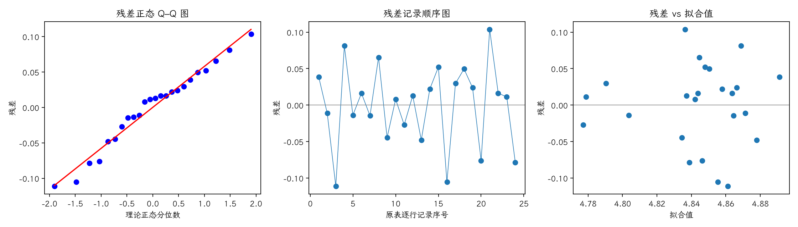
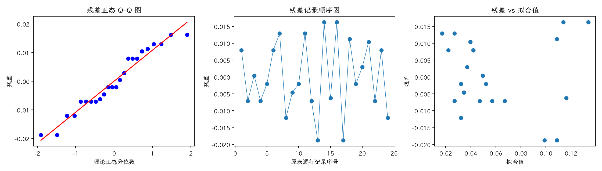

(exercise-4-18)=
# 习题 4.18：比率控制算法与槽电压

[习题与答案](../../index.md) / [第 4 章　随机区组、拉丁方与相关设计](../chapter04.md)

第 9 版 · 第 4 章 · 原书章末习题见印刷页 171～178。题目依据第 9 版，参考答案按题意匹配。

## 题目

第 3.8 节的比率控制算法试验实际按随机区组设计进行，以 6 个时间段为区组，每个时间段测试全部 4 种算法。记录平均槽电压和电压标准差（pot noise）。

**平均电压**

| 处理／区组（4.17 为组内受试者序号） | 1 | 2 | 3 | 4 | 5 | 6 |
| --- | --- | --- | --- | --- | --- | --- |
| 1 | 4.93 | 4.86 | 4.75 | 4.95 | 4.79 | 4.88 |
| 2 | 4.85 | 4.91 | 4.79 | 4.85 | 4.75 | 4.85 |
| 3 | 4.83 | 4.88 | 4.9 | 4.75 | 4.82 | 4.9 |
| 4 | 4.89 | 4.77 | 4.94 | 4.86 | 4.79 | 4.76 |

**电压标准差（与上表逐项对应）**

| 处理／区组（4.17 为组内受试者序号） | 1 | 2 | 3 | 4 | 5 | 6 |
| --- | --- | --- | --- | --- | --- | --- |
| 1 | 0.05 | 0.04 | 0.05 | 0.06 | 0.03 | 0.05 |
| 2 | 0.04 | 0.02 | 0.03 | 0.05 | 0.03 | 0.02 |
| 3 | 0.09 | 0.13 | 0.11 | 0.15 | 0.08 | 0.12 |
| 4 | 0.03 | 0.04 | 0.05 | 0.05 | 0.03 | 0.02 |

**（a）** 平均电压是否受算法影响？取 $\alpha=0.05$。

**（b）** 分析电压标准差，算法是否影响 pot noise？

**（c）** 进行适当残差分析。

**（d）** 若要同时降低平均电压与噪声，选择哪种算法？

## 答案与解析

### （a）平均电压

**模型与假设**：$y_{ij}=\mu+\tau_i+\beta_j+\epsilon_{ij}$，$\sum_i\tau_i=\sum_j\beta_j=0$；误差独立且服从 $N(0,\sigma^2)$，处理与区组效应可加，没有处理×区组交互作用。处理在各区组内随机分配。

**假设与检验**：$H_0:\tau_1=\cdots=\tau_a=0$；$H_1$：至少一个处理效应非零。令 $C=G^2/(ab)$，$T_i$、$B_j$ 分别为处理及区组总和，

$$SS_T=\sum_{ij}y_{ij}^2-C,\quad SS_A=\frac{\sum_iT_i^2}{b}-C,\quad SS_B=\frac{\sum_jB_j^2}{a}-C,$$
$$SS_E=SS_T-SS_A-SS_B,\quad F_0=\frac{SS_A/(a-1)}{SS_E/[(a-1)(b-1)]}\sim F_{a-1,(a-1)(b-1)}\quad(H_0).$$

除题目另有说明，取 $\alpha=0.05$，以 $P<0.05$ 拒绝原假设。本文 $t_q,F_q$ 均指下侧累积概率为 $q$ 的分位数。区组作为控制因素，不将其显著性作为保留区组的前提。

| 来源 | 自由度 | 平方和 | 均方 | $F$ | $P$ 值 |
| --- | --- | --- | --- | --- | --- |
| 区组 | 5 | 0.0174375 | 0.0034875 | 0.724759 | 0.615371 |
| 处理（调整后） | 3 | 0.00274583 | 0.000915278 | 0.19021 | 0.901415 |
| 误差 | 15 | 0.0721792 | 0.00481194 | — | — |
| 总计 | 23 | 0.0923625 | — | — | — |

$F_0=0.19021$，$P=0.901415$，不拒绝处理均值相等的原假设；尚无充分证据认定处理均值不同。

### （b）槽噪声

**模型与假设**：$y_{ij}=\mu+\tau_i+\beta_j+\epsilon_{ij}$，$\sum_i\tau_i=\sum_j\beta_j=0$；误差独立且服从 $N(0,\sigma^2)$，处理与区组效应可加，没有处理×区组交互作用。处理在各区组内随机分配。

**假设与检验**：$H_0:\tau_1=\cdots=\tau_a=0$；$H_1$：至少一个处理效应非零。令 $C=G^2/(ab)$，$T_i$、$B_j$ 分别为处理及区组总和，

$$SS_T=\sum_{ij}y_{ij}^2-C,\quad SS_A=\frac{\sum_iT_i^2}{b}-C,\quad SS_B=\frac{\sum_jB_j^2}{a}-C,$$
$$SS_E=SS_T-SS_A-SS_B,\quad F_0=\frac{SS_A/(a-1)}{SS_E/[(a-1)(b-1)]}\sim F_{a-1,(a-1)(b-1)}\quad(H_0).$$

除题目另有说明，取 $\alpha=0.05$，以 $P<0.05$ 拒绝原假设。本文 $t_q,F_q$ 均指下侧累积概率为 $q$ 的分位数。区组作为控制因素，不将其显著性作为保留区组的前提。

| 来源 | 自由度 | 平方和 | 均方 | $F$ | $P$ 值 |
| --- | --- | --- | --- | --- | --- |
| 区组 | 5 | 0.00272083 | 0.000544167 | 3.18537 | 0.0371108 |
| 处理（调整后） | 3 | 0.0260125 | 0.00867083 | 50.7561 | 4.34468e-08 |
| 误差 | 15 | 0.0025625 | 0.000170833 | — | — |
| 总计 | 23 | 0.0312958 | — | — | — |

$F_0=50.7561$，$P=4.34468e-08$，拒绝处理均值相等的原假设，有处理差异的证据。

### （c）两个响应的诊断

残差为 $e=y-X\hat\theta$。左图检查正态性及极端残差，右图检查方差和均值结构。中图按表中逐行记录顺序绘制；题目未给出实际随机运行顺序，**它不是真实时序图，不能据此确认时间独立性**。需获得运行日志后再按实际时间重画。未见明显图形异常也不能证明假设成立。

残差 Shapiro–Wilk 统计量 $W=0.969257$、$P=0.648668$（作为辅助描述，拟合残差相互相关，不能当成独立原始样本的精确检验）。未检出明显的正态性偏离；小样本下检验功效有限，仍应结合 Q–Q 图判断。

残差为 $e=y-X\hat\theta$。左图检查正态性及极端残差，右图检查方差和均值结构。中图按表中逐行记录顺序绘制；题目未给出实际随机运行顺序，**它不是真实时序图，不能据此确认时间独立性**。需获得运行日志后再按实际时间重画。未见明显图形异常也不能证明假设成立。

残差 Shapiro–Wilk 统计量 $W=0.946083$、$P=0.222511$（作为辅助描述，拟合残差相互相关，不能当成独立原始样本的精确检验）。未检出明显的正态性偏离；小样本下检验功效有限，仍应结合 Q–Q 图判断。

噪声响应在算法 3 下较大且离散更强，方差结构须谨慎评价，可另考察对数标准差模型。

### （d）算法选择

| 处理 | 样本均值 |
| --- | --- |
| 1 | 4.86 |
| 2 | 4.83333 |
| 3 | 4.84667 |
| 4 | 4.835 |

噪声均值依次为 0.0466667、0.0316667、0.113333、0.0366667。算法 2 的平均电压较低且噪声最低，是兼顾两响应的合理选择；平均电压检验不显著，不能声称它在总体上电压显著最小。

---

**答案来源**：按题意对应 `Exercises/ch04.pdf` 的 4.16；公式与数值由编者复核，补充完整推导与诊断。

← [上一题 4.17](./exercise-4-17.md) · [本章题目目录](../chapter04.md) · [下一题 4.19](./exercise-4-19.md) →
