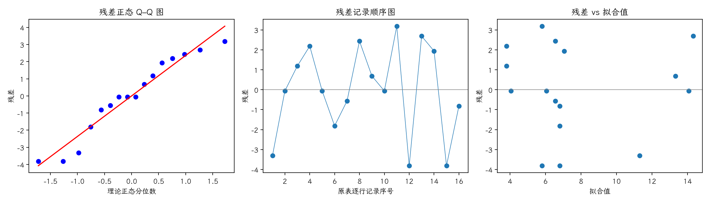
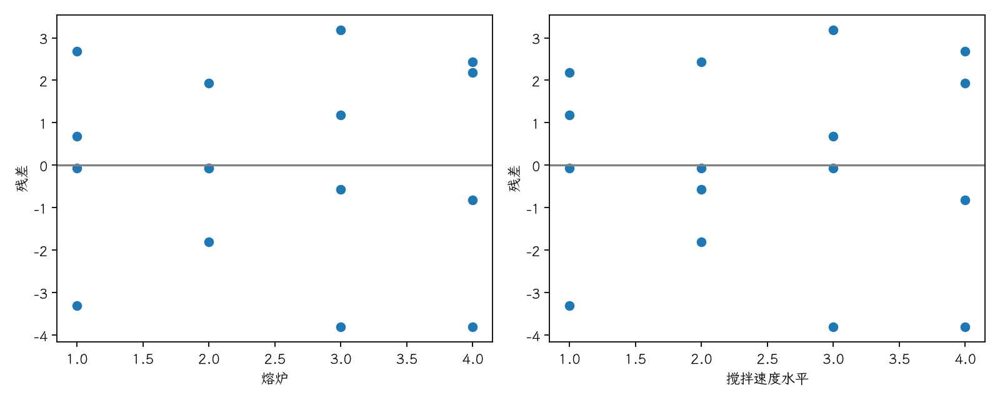

(exercise-4-19)=
# 习题 4.19：搅拌速度与晶粒尺寸

[习题与答案](../../index.md) / [第 4 章　随机区组、拉丁方与相关设计](../chapter04.md)

第 9 版 · 第 4 章 · 原书章末习题见印刷页 171～178。题目依据第 9 版，参考答案按题意匹配。

## 题目

铝母合金生产商使用 4 台具有不同运行特性的熔炉，以熔炉为区组，研究 5、10、15、20 rpm 搅拌速度对晶粒尺寸的影响。

| 处理／区组（4.17 为组内受试者序号） | 1 | 2 | 3 | 4 |
| --- | --- | --- | --- | --- |
| 5 rpm | 8 | 4 | 5 | 6 |
| 10 rpm | 14 | 5 | 6 | 9 |
| 15 rpm | 14 | 6 | 9 | 2 |
| 20 rpm | 17 | 9 | 3 | 6 |

**（a）** 有证据认为搅拌速度影响晶粒尺寸吗？

**（b）** 绘制残差正态概率图并解释。

**（c）** 绘制残差对熔炉及速度图，解释其信息。

**（d）** 若希望晶粒较小，应推荐什么速度和熔炉？

## 答案与解析

### （a）方差分析

**模型与假设**：$y_{ij}=\mu+\tau_i+\beta_j+\epsilon_{ij}$，$\sum_i\tau_i=\sum_j\beta_j=0$；误差独立且服从 $N(0,\sigma^2)$，处理与区组效应可加，没有处理×区组交互作用。处理在各区组内随机分配。

**假设与检验**：$H_0:\tau_1=\cdots=\tau_a=0$；$H_1$：至少一个处理效应非零。令 $C=G^2/(ab)$，$T_i$、$B_j$ 分别为处理及区组总和，

$$SS_T=\sum_{ij}y_{ij}^2-C,\quad SS_A=\frac{\sum_iT_i^2}{b}-C,\quad SS_B=\frac{\sum_jB_j^2}{a}-C,$$
$$SS_E=SS_T-SS_A-SS_B,\quad F_0=\frac{SS_A/(a-1)}{SS_E/[(a-1)(b-1)]}\sim F_{a-1,(a-1)(b-1)}\quad(H_0).$$

除题目另有说明，取 $\alpha=0.05$，以 $P<0.05$ 拒绝原假设。本文 $t_q,F_q$ 均指下侧累积概率为 $q$ 的分位数。区组作为控制因素，不将其显著性作为保留区组的前提。

| 来源 | 自由度 | 平方和 | 均方 | $F$ | $P$ 值 |
| --- | --- | --- | --- | --- | --- |
| 区组 | 3 | 165.188 | 55.0625 | 6.34828 | 0.0133403 |
| 处理（调整后） | 3 | 22.1875 | 7.39583 | 0.852682 | 0.499539 |
| 误差 | 9 | 78.0625 | 8.67361 | — | — |
| 总计 | 15 | 265.438 | — | — | — |

$F_0=0.852682$，$P=0.499539$，不拒绝处理均值相等的原假设；尚无充分证据认定处理均值不同。

### （b）残差正态图

残差为 $e=y-X\hat\theta$。左图检查正态性及极端残差，右图检查方差和均值结构。中图按表中逐行记录顺序绘制；题目未给出实际随机运行顺序，**它不是真实时序图，不能据此确认时间独立性**。需获得运行日志后再按实际时间重画。未见明显图形异常也不能证明假设成立。

残差 Shapiro–Wilk 统计量 $W=0.930103$、$P=0.244709$（作为辅助描述，拟合残差相互相关，不能当成独立原始样本的精确检验）。未检出明显的正态性偏离；小样本下检验功效有限，仍应结合 Q–Q 图判断。

### （c）残差对因子

部分熔炉的响应对速度变化不同，提示可加性可能不足。每个组合只有一次观测，无法独立估计交互作用；需要重复试验验证。

### （d）工艺建议

| 处理 | 样本均值 |
| --- | --- |
| 5 rpm | 5.75 |
| 10 rpm | 8.5 |
| 15 rpm | 7.75 |
| 20 rpm | 8.75 |

熔炉均值依次为 13.25、6、5.75、5.75。样本上 5 rpm 和熔炉 3 的边际均值较低，可作为后续验证起点；速度主效应未显著，不能据此宣布该速度最优，也不能把单个最小单元等同于最优工艺。

---

**答案来源**：按题意对应 `Exercises/ch04.pdf` 的 4.17S；公式与数值由编者复核，补充完整推导与诊断。

← [上一题 4.18](./exercise-4-18.md) · [本章题目目录](../chapter04.md) · [下一题 4.20](./exercise-4-20.md) →
