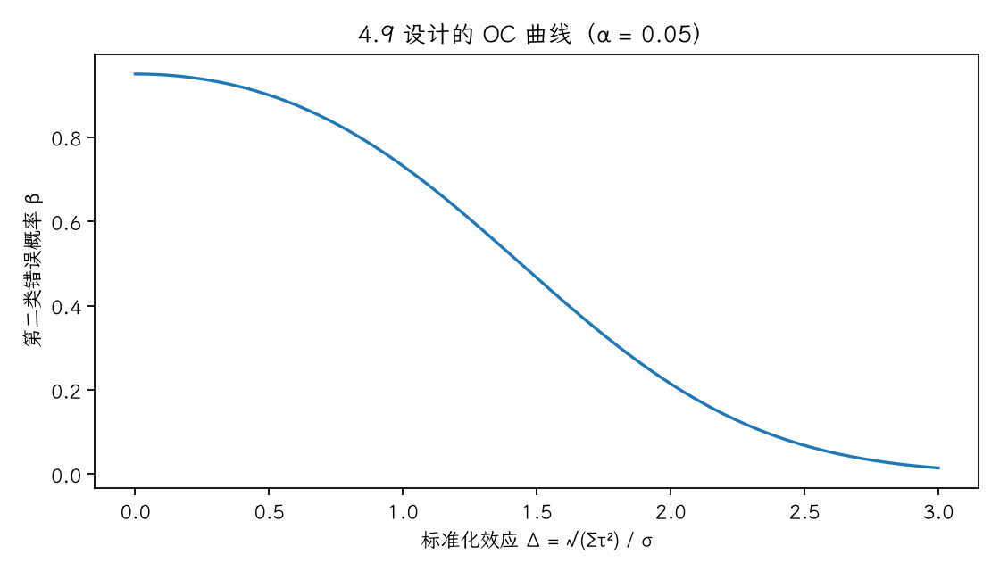

(exercise-4-22)=
# 习题 4.22：洗涤液试验的操作特性曲线

[习题与答案](../../index.md) / [第 4 章　随机区组、拉丁方与相关设计](../chapter04.md)

第 9 版 · 第 4 章 · 原书章末习题见印刷页 171～178。题目依据第 9 版，参考答案按题意匹配。

## 题目

为习题 [4.9](./exercise-4-9.md) 的设计绘制 OC 曲线。该检验对处理效应的小差异敏感吗？

## 答案与解析

固定效应 RCBD 中 $a=3,b=4$，非中心参数 $\Lambda=b\sum_i\tau_i^2/\sigma^2$，自由度为 $(2,6)$。定义 $\Delta=\sqrt{\sum_i\tau_i^2}/\sigma$，则 $\Lambda=4\Delta^2$，

$$\beta(\Delta)=P\{F_{2,6}(4\Delta^2)\le F_{0.95;2,6}\},\qquad \mathrm{Power}=1-\beta.$$

| Δ | 功效 |
| --- | --- |
| 0.5 | 0.100113 |
| 1 | 0.268218 |
| 1.5 | 0.534127 |
| 2 | 0.785535 |

当效应相对误差较小时，功效较低；只有 4 个区组，不能认为它能灵敏检出任意小差异。

---

**答案来源**：按题意对应 `Exercises/ch04.pdf` 的 4.20；公式与数值由编者复核，补充完整推导与诊断。

← [上一题 4.21](./exercise-4-21.md) · [本章题目目录](../chapter04.md) · [下一题 4.23](./exercise-4-23.md) →
