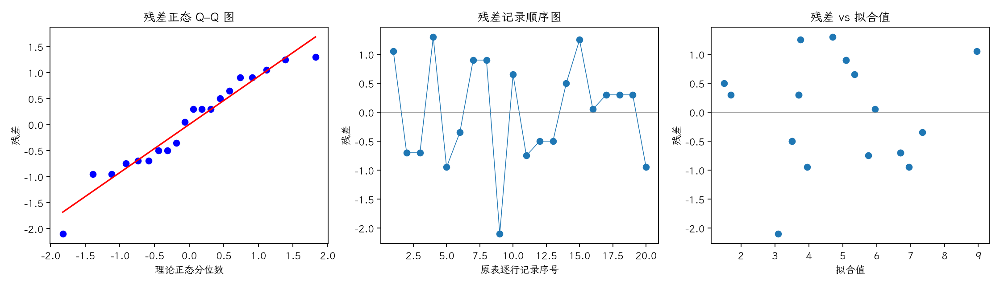

(exercise-4-26)=
# 习题 4.26：距离与眼睛聚焦时间

[习题与答案](../../index.md) / [第 4 章　随机区组、拉丁方与相关设计](../chapter04.md)

第 9 版 · 第 4 章 · 原书章末习题见印刷页 171～178。题目依据第 9 版，参考答案按题意匹配。

## 题目

工业工程师研究物体距眼睛的距离对聚焦时间的影响。比较 4、6、8、10 ft，以 5 名受试者为区组，每人接受全部距离条件。

| 处理／区组（4.17 为组内受试者序号） | 1 | 2 | 3 | 4 | 5 |
| --- | --- | --- | --- | --- | --- |
| 4 ft | 10 | 6 | 6 | 6 | 6 |
| 6 ft | 7 | 6 | 6 | 1 | 6 |
| 8 ft | 5 | 3 | 3 | 2 | 5 |
| 10 ft | 6 | 4 | 4 | 2 | 3 |

以 $\alpha=0.05$ 分析数据并给出结论。

## 答案与解析

**模型与假设**：$y_{ij}=\mu+\tau_i+\beta_j+\epsilon_{ij}$，$\sum_i\tau_i=\sum_j\beta_j=0$；误差独立且服从 $N(0,\sigma^2)$，处理与区组效应可加，没有处理×区组交互作用。处理在各区组内随机分配。

**假设与检验**：$H_0:\tau_1=\cdots=\tau_a=0$；$H_1$：至少一个处理效应非零。令 $C=G^2/(ab)$，$T_i$、$B_j$ 分别为处理及区组总和，

$$SS_T=\sum_{ij}y_{ij}^2-C,\quad SS_A=\frac{\sum_iT_i^2}{b}-C,\quad SS_B=\frac{\sum_jB_j^2}{a}-C,$$
$$SS_E=SS_T-SS_A-SS_B,\quad F_0=\frac{SS_A/(a-1)}{SS_E/[(a-1)(b-1)]}\sim F_{a-1,(a-1)(b-1)}\quad(H_0).$$

除题目另有说明，取 $\alpha=0.05$，以 $P<0.05$ 拒绝原假设。本文 $t_q,F_q$ 均指下侧累积概率为 $q$ 的分位数。区组作为控制因素，不将其显著性作为保留区组的前提。

| 来源 | 自由度 | 平方和 | 均方 | $F$ | $P$ 值 |
| --- | --- | --- | --- | --- | --- |
| 区组 | 4 | 36.3 | 9.075 | 7.11765 | 0.00354812 |
| 处理（调整后） | 3 | 32.95 | 10.9833 | 8.61438 | 0.00254327 |
| 误差 | 12 | 15.3 | 1.275 | — | — |
| 总计 | 19 | 84.55 | — | — | — |

$F_0=8.61438$，$P=0.00254327$，拒绝处理均值相等的原假设，有处理差异的证据。

残差为 $e=y-X\hat\theta$。左图检查正态性及极端残差，右图检查方差和均值结构。中图按表中逐行记录顺序绘制；题目未给出实际随机运行顺序，**它不是真实时序图，不能据此确认时间独立性**。需获得运行日志后再按实际时间重画。未见明显图形异常也不能证明假设成立。

残差 Shapiro–Wilk 统计量 $W=0.949758$、$P=0.363434$（作为辅助描述，拟合残差相互相关，不能当成独立原始样本的精确检验）。未检出明显的正态性偏离；小样本下检验功效有限，仍应结合 Q–Q 图判断。

---

**答案来源**：按题意对应 `Exercises/ch04.pdf` 的 4.23；公式与数值由编者复核，补充完整推导与诊断。

← [上一题 4.25](./exercise-4-25.md) · [本章题目目录](../chapter04.md) · [下一题 4.27](./exercise-4-27.md) →
