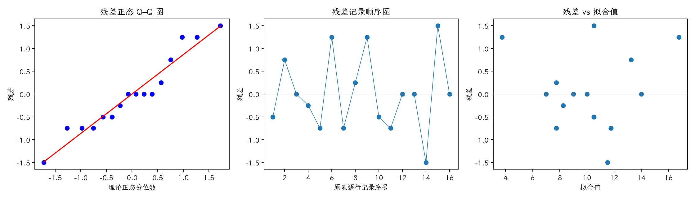

(exercise-4-28)=
# 习题 4.28：装配方法的拉丁方

[习题与答案](../../index.md) / [第 4 章　随机区组、拉丁方与相关设计](../chapter04.md)

第 9 版 · 第 4 章 · 原书章末习题见印刷页 171～178。题目依据第 9 版，参考答案按题意匹配。

## 题目

工程师比较 4 种电视部件装配方法 A～D。选 4 名操作员，并用装配次序控制疲劳影响，以次序为行、操作员为列安排拉丁方，响应为装配时间。

| 行／列 | 1 | 2 | 3 | 4 |
| --- | --- | --- | --- | --- |
| 1 | C = 10 | D = 14 | A = 7 | B = 8 |
| 2 | B = 7 | C = 18 | D = 11 | A = 8 |
| 3 | A = 5 | B = 10 | C = 11 | D = 9 |
| 4 | D = 10 | A = 10 | B = 12 | C = 14 |

以 $\alpha=0.05$ 分析数据并给出结论。

## 答案与解析

**模型与假设**：$y_{ij}=\mu+\tau_{L(i,j)}+\rho_i+\kappa_j+\epsilon_{ij}$，各组效应和为零；各误差独立同分布为 $N(0,\sigma^2)$，所有因子效应可加，没有交互作用。$L(i,j)$ 是该单元的处理标签。行、列及处理均为固定效应。

**原假设与备择假设**：$H_0:\tau_1=\cdots=\tau_p=0$；$H_1$：至少一个处理效应不为零。设 $C=G^2/p^2$，各因子水平总和为 $U_l$，

$$SS_T=\sum y^2-C,\qquad SS_{\text{因子}}=\frac1p\sum_lU_l^2-C,$$
$$SS_E=SS_T-SS_A-SS_R-SS_C,\qquad F_0=\frac{SS_A/(p-1)}{SS_E/[(p-1)(p-2)]}.$$

显著性水平取 $0.05$；处理、行、列自由度各为 $p-1$，总自由度 $p^2-1$。

| 来源 | 自由度 | 平方和 | 均方 | $F$ | $P$ 值 |
| --- | --- | --- | --- | --- | --- |
| 行 | 3 | 18.5 | 6.16667 | 3.52381 | 0.0885187 |
| 列 | 3 | 51.5 | 17.1667 | 9.80952 | 0.00992587 |
| 处理（调整后） | 3 | 72.5 | 24.1667 | 13.8095 | 0.00421304 |
| 误差 | 6 | 10.5 | 1.75 | — | — |
| 总计 | 15 | 153 | — | — | — |

$F_0=13.8095$，$P=0.00421304$，拒绝处理均值相等的原假设，有处理差异的证据。

残差为 $e=y-X\hat\theta$。左图检查正态性及极端残差，右图检查方差和均值结构。中图按表中逐行记录顺序绘制；题目未给出实际随机运行顺序，**它不是真实时序图，不能据此确认时间独立性**。需获得运行日志后再按实际时间重画。未见明显图形异常也不能证明假设成立。

残差 Shapiro–Wilk 统计量 $W=0.940916$、$P=0.360392$（作为辅助描述，拟合残差相互相关，不能当成独立原始样本的精确检验）。未检出明显的正态性偏离；小样本下检验功效有限，仍应结合 Q–Q 图判断。

---

**答案来源**：按题意对应 `Exercises/ch04.pdf` 的 4.25S；公式与数值由编者复核，补充完整推导与诊断。

← [上一题 4.27](./exercise-4-27.md) · [本章题目目录](../chapter04.md) · [下一题 4.29](./exercise-4-29.md) →
