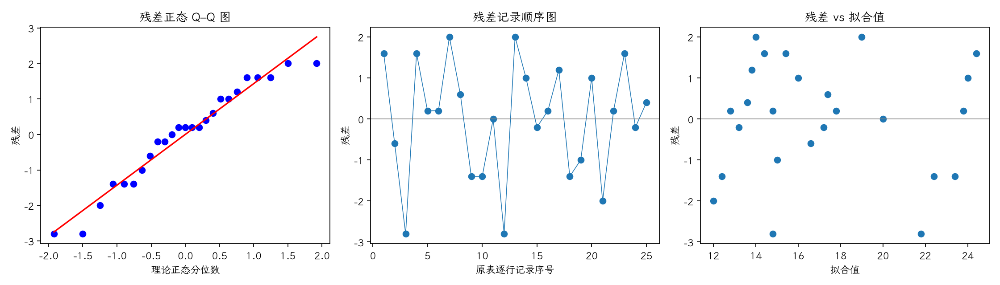

(exercise-4-40)=
# 习题 4.40：化学产率的希腊—拉丁方

[习题与答案](../../index.md) / [第 4 章　随机区组、拉丁方与相关设计](../chapter04.md)

第 9 版 · 第 4 章 · 原书章末习题见印刷页 171～178。题目依据第 9 版，参考答案按题意匹配。

## 题目

化学过程产率试验包含 5 批原料（行）、5 种酸浓度（列）、5 种静置时间 A～E 和 5 种催化剂浓度 α～ε，采用下列希腊—拉丁方。

| 行／列 | 1 | 2 | 3 | 4 | 5 |
| --- | --- | --- | --- | --- | --- |
| 1 | Aα = 26 | Bβ = 16 | Cγ = 19 | Dδ = 16 | Eε = 13 |
| 2 | Bγ = 18 | Cδ = 21 | Dε = 18 | Eα = 11 | Aβ = 21 |
| 3 | Cε = 20 | Dα = 12 | Eβ = 16 | Aγ = 25 | Bδ = 13 |
| 4 | Dβ = 15 | Eγ = 15 | Aδ = 22 | Bε = 14 | Cα = 17 |
| 5 | Eδ = 10 | Aε = 24 | Bα = 17 | Cβ = 17 | Dγ = 14 |

以 $\alpha=0.05$ 分析数据并给出结论。

## 答案与解析

**模型与假设**：$y_{ij}=\mu+\tau_{L(i,j)}+\rho_i+\kappa_j+\epsilon_{ij}$，各组效应和为零；各误差独立同分布为 $N(0,\sigma^2)$，所有因子效应可加，没有交互作用。$L(i,j)$ 是该单元的处理标签。行、列及处理均为固定效应。

**原假设与备择假设**：$H_0:\tau_1=\cdots=\tau_p=0$；$H_1$：至少一个处理效应不为零。设 $C=G^2/p^2$，各因子水平总和为 $U_l$，

$$SS_T=\sum y^2-C,\qquad SS_{\mathrm{因子}}=\frac1p\sum_lU_l^2-C,$$
$$SS_E=SS_T-SS_A-SS_R-SS_C,\qquad F_0=\frac{SS_A/(p-1)}{SS_E/[(p-1)(p-2)]}.$$

显著性水平取 $0.05$；处理、行、列自由度各为 $p-1$，总自由度 $p^2-1$。

再加入希腊字母因子 $\gamma_{G(i,j)}$（效应和为零），从总平方和再减去 $SS_G$；误差自由度改为 $(p-1)(p-3)$，其余假设与检验方式相同。

| 来源 | 自由度 | 平方和 | 均方 | $F$ | $P$ 值 |
| --- | --- | --- | --- | --- | --- |
| 行 | 4 | 10 | 2.5 | 0.42735 | 0.785447 |
| 列 | 4 | 24.4 | 6.1 | 1.04274 | 0.442543 |
| 希腊字母因子 | 4 | 12 | 3 | 0.512821 | 0.7289 |
| 处理（调整后） | 4 | 342.8 | 85.7 | 14.6496 | 0.00094102 |
| 误差 | 8 | 46.8 | 5.85 | — | — |
| 总计 | 24 | 436 | — | — | — |

$F_0=14.6496$，$P=0.00094102$，拒绝处理均值相等的原假设，有处理差异的证据。

残差为 $e=y-X\hat\theta$。左图检查正态性及极端残差，右图检查方差和均值结构。中图按表中逐行记录顺序绘制；题目未给出实际随机运行顺序，**它不是真实时序图，不能据此确认时间独立性**。需获得运行日志后再按实际时间重画。未见明显图形异常也不能证明假设成立。

残差 Shapiro–Wilk 统计量 $W=0.947207$、$P=0.216717$（作为辅助描述，拟合残差相互相关，不能当成独立原始样本的精确检验）。未检出明显的正态性偏离；小样本下检验功效有限，仍应结合 Q–Q 图判断。

---

**答案来源**：按题意对应 `Exercises/ch04.pdf` 的 4.37；公式与数值由编者复核，补充完整推导与诊断。

← [上一题 4.39](./exercise-4-39.md) · [本章题目目录](../chapter04.md) · [下一题 4.41](./exercise-4-41.md) →
