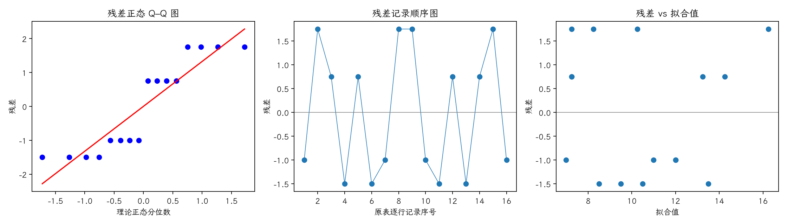

(exercise-4-41)=
# 习题 4.41：增加工作场所的装配试验

[习题与答案](../../index.md) / [第 4 章　随机区组、拉丁方与相关设计](../chapter04.md)

第 9 版 · 第 4 章 · 原书章末习题见印刷页 171～178。题目依据第 9 版，参考答案按题意匹配。

## 题目

在习题 4.28 的研究中，工程师进一步以工作场所 α～δ 控制潜在变异。重新试验得到下列希腊—拉丁方：行为装配次序，列为操作员，A～D 为方法，α～δ 为工作场所。

| 行／列 | 1 | 2 | 3 | 4 |
| --- | --- | --- | --- | --- |
| 1 | Cβ = 11 | Bγ = 10 | Dδ = 14 | Aα = 8 |
| 2 | Bα = 8 | Cδ = 12 | Aγ = 10 | Dβ = 12 |
| 3 | Aδ = 9 | Dα = 11 | Bβ = 7 | Cγ = 15 |
| 4 | Dγ = 9 | Aβ = 8 | Cα = 18 | Bδ = 6 |

以 $\alpha=0.05$ 分析数据并给出结论。

## 答案与解析

**模型与假设**：依据教材 [§4.3 格拉科–拉丁方设计](../../../Chapter%2004/translations_zh/03_4.3_The_Graeco-Latin_Square_Design_zh.md) 的式（4.29），采用四因子加性模型

$$y_{ijkl}=\mu+\theta_i+\tau_j+\omega_k+\Psi_l+\varepsilon_{ijkl}.$$

其中 $i$ 为行，$j$ 为拉丁字母处理，$k$ 为希腊字母因子，$l$ 为列；$\theta_i,\tau_j,\omega_k,\Psi_l$ 分别为对应效应，所有下标均取 $1,\ldots,p$。只在设计安排的 $p^2$ 个单元上观测，行、列确定后，两个字母标签也随之确定，并非有 $p^4$ 个观测。四个因子均按固定效应处理，约束为

$$\sum_i\theta_i=\sum_j\tau_j=\sum_k\omega_k=\sum_l\Psi_l=0.$$

假定误差独立同分布为 $N(0,\sigma^2)$，四个因子效应可加，不存在交互作用。两个拉丁方正交：每个字母在每行、每列恰出现一次，且每个拉丁–希腊字母对恰出现一次。

**原假设与备择假设**：拉丁字母处理检验 $H_0^{(L)}:\tau_1=\cdots=\tau_p=0$，$H_1^{(L)}$：至少一个 $\tau_j\ne0$。希腊字母因子检验 $H_0^{(G)}:\omega_1=\cdots=\omega_p=0$，$H_1^{(G)}$：至少一个 $\omega_k\ne0$。行、列检验分别以所有 $\theta_i=0$、所有 $\Psi_l=0$ 为原假设，备择均为至少一个相应效应非零。

**平方和与检验统计量**：按教材表 4.19，令 $C_0=y_{....}^2/p^2$，点号表示对实际观测求和；以下总和均只遍历设计中的 $p^2$ 个观测。

$$SS_T=\sum_{\text{实际观测}}y_{ijkl}^2-C_0,$$
$$SS_R=\frac1p\sum_i y_{i...}^2-C_0,\qquad SS_C=\frac1p\sum_l y_{...l}^2-C_0,$$
$$SS_L=\frac1p\sum_j y_{.j..}^2-C_0,\qquad SS_G=\frac1p\sum_k y_{..k.}^2-C_0,$$
$$SS_E=SS_T-SS_R-SS_C-SS_L-SS_G,\qquad df_E=p^2-1-4(p-1)=(p-1)(p-3).$$

对任一因子 $Q\in\{R,C,L,G\}$，

$$MS_Q=\frac{SS_Q}{p-1},\qquad MS_E=\frac{SS_E}{(p-1)(p-3)},\qquad F_Q=\frac{MS_Q}{MS_E}\sim F_{p-1,(p-1)(p-3)}\quad(H_0^{(Q)}).$$

取显著性水平 $\alpha=0.05$，以 $F_Q>F_{0.95;p-1,(p-1)(p-3)}$（或 $P<0.05$）拒绝相应原假设。四个因子的自由度各为 $p-1$，总自由度为 $p^2-1$。表中“处理”对应拉丁字母因子 $L$。

本题 $p=4$；$\theta_i$ 为装配次序效应，$\Psi_l$ 为操作员效应，$\tau_j$ 为装配方法效应，$\omega_k$ 为工作场所效应。误差自由度为 $(4-1)(4-3)=3$。

| 来源 | 自由度 | 平方和 | 均方 | $F$ | $P$ 值 |
| --- | --- | --- | --- | --- | --- |
| 行 | 3 | 0.5 | 0.166667 | 0.0181818 | 0.995971 |
| 列 | 3 | 19 | 6.33333 | 0.690909 | 0.61572 |
| 希腊字母因子 | 3 | 7.5 | 2.5 | 0.272727 | 0.84288 |
| 处理（调整后） | 3 | 95.5 | 31.8333 | 3.47273 | 0.166904 |
| 误差 | 3 | 27.5 | 9.16667 | — | — |
| 总计 | 15 | 150 | — | — | — |

$F_0=3.47273$，$P=0.166904$，不拒绝处理均值相等的原假设；尚无充分证据认定处理均值不同。

残差为 $e=y-X\hat\theta$。左图检查正态性及极端残差，右图检查方差和均值结构。中图按表中逐行记录顺序绘制；题目未给出实际随机运行顺序，**它不是真实时序图，不能据此确认时间独立性**。需获得运行日志后再按实际时间重画。未见明显图形异常也不能证明假设成立。

残差 Shapiro–Wilk 统计量 $W=0.813278$、$P=0.00411013$（作为辅助描述，拟合残差相互相关，不能当成独立原始样本的精确检验）。正态性检验提示残差偏离正态，应结合 Q–Q 图中的尾部和异常值谨慎解释 F 检验。

---

**答案来源**：按题意对应 `Exercises/ch04.pdf` 的 4.38；公式与数值由编者复核，补充完整推导与诊断。

← [上一题 4.40](./exercise-4-40.md) · [本章题目目录](../chapter04.md) · [下一题 4.42](./exercise-4-42.md) →
