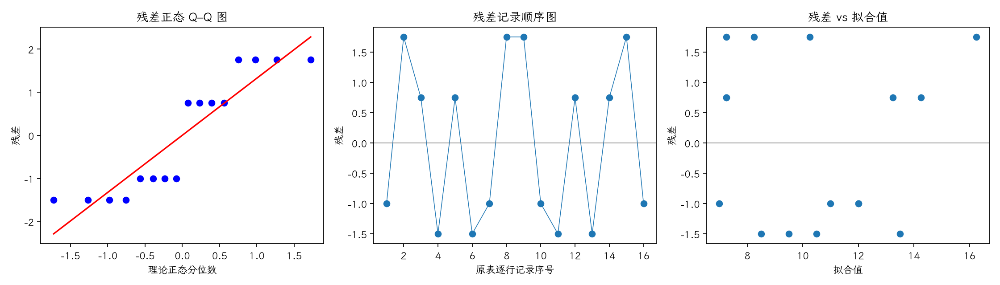

(exercise-4-41)=
# 习题 4.41：增加工作场所的装配试验

[习题与答案](../../index.md) / [第 4 章　随机区组、拉丁方与相关设计](../chapter04.md)

第 9 版 · 第 4 章 · 原书章末习题见印刷页 171～178。题目依据第 9 版，参考答案按题意匹配。

## 题目

在习题 4.28 的研究中，工程师进一步以工作场所 α～δ 控制潜在变异。重新试验得到下列希腊—拉丁方：行为装配次序，列为操作员，A～D 为方法，α～δ 为工作场所。

| 行／列 | 1 | 2 | 3 | 4 |
| --- | --- | --- | --- | --- |
| 1 | Cβ = 11 | Bγ = 10 | Dδ = 14 | Aα = 8 |
| 2 | Bα = 8 | Cδ = 12 | Aγ = 10 | Dβ = 12 |
| 3 | Aδ = 9 | Dα = 11 | Bβ = 7 | Cγ = 15 |
| 4 | Dγ = 9 | Aβ = 8 | Cα = 18 | Bδ = 6 |

以 $\alpha=0.05$ 分析数据并给出结论。

## 答案与解析

**模型与假设**：$y_{ij}=\mu+\tau_{L(i,j)}+\rho_i+\kappa_j+\epsilon_{ij}$，各组效应和为零；各误差独立同分布为 $N(0,\sigma^2)$，所有因子效应可加，没有交互作用。$L(i,j)$ 是该单元的处理标签。行、列及处理均为固定效应。

**原假设与备择假设**：$H_0:\tau_1=\cdots=\tau_p=0$；$H_1$：至少一个处理效应不为零。设 $C=G^2/p^2$，各因子水平总和为 $U_l$，

$$SS_T=\sum y^2-C,\qquad SS_{\mathrm{因子}}=\frac1p\sum_lU_l^2-C,$$
$$SS_E=SS_T-SS_A-SS_R-SS_C,\qquad F_0=\frac{SS_A/(p-1)}{SS_E/[(p-1)(p-2)]}.$$

显著性水平取 $0.05$；处理、行、列自由度各为 $p-1$，总自由度 $p^2-1$。

再加入希腊字母因子 $\gamma_{G(i,j)}$（效应和为零），从总平方和再减去 $SS_G$；误差自由度改为 $(p-1)(p-3)$，其余假设与检验方式相同。

| 来源 | 自由度 | 平方和 | 均方 | $F$ | $P$ 值 |
| --- | --- | --- | --- | --- | --- |
| 行 | 3 | 0.5 | 0.166667 | 0.0181818 | 0.995971 |
| 列 | 3 | 19 | 6.33333 | 0.690909 | 0.61572 |
| 希腊字母因子 | 3 | 7.5 | 2.5 | 0.272727 | 0.84288 |
| 处理（调整后） | 3 | 95.5 | 31.8333 | 3.47273 | 0.166904 |
| 误差 | 3 | 27.5 | 9.16667 | — | — |
| 总计 | 15 | 150 | — | — | — |

$F_0=3.47273$，$P=0.166904$，不拒绝处理均值相等的原假设；尚无充分证据认定处理均值不同。

残差为 $e=y-X\hat\theta$。左图检查正态性及极端残差，右图检查方差和均值结构。中图按表中逐行记录顺序绘制；题目未给出实际随机运行顺序，**它不是真实时序图，不能据此确认时间独立性**。需获得运行日志后再按实际时间重画。未见明显图形异常也不能证明假设成立。

残差 Shapiro–Wilk 统计量 $W=0.813278$、$P=0.00411013$（作为辅助描述，拟合残差相互相关，不能当成独立原始样本的精确检验）。正态性检验提示残差偏离正态，应结合 Q–Q 图中的尾部和异常值谨慎解释 F 检验。

---

**答案来源**：按题意对应 `Exercises/ch04.pdf` 的 4.38；公式与数值由编者复核，补充完整推导与诊断。

← [上一题 4.40](./exercise-4-40.md) · [本章题目目录](../chapter04.md) · [下一题 4.42](./exercise-4-42.md) →
