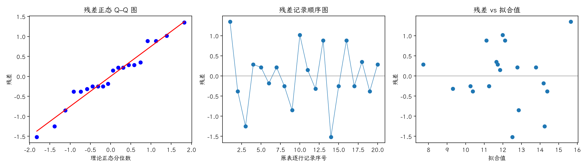

(exercise-4-45)=
# 习题 4.45：汽油添加剂的不完全区组试验

[习题与答案](../../index.md) / [第 4 章　随机区组、拉丁方与相关设计](../chapter04.md)

第 9 版 · 第 4 章 · 原书章末习题见印刷页 171～178。题目依据第 9 版，参考答案按题意匹配。

## 题目

工程师比较 5 种汽油添加剂对行驶里程的影响，以汽车为区组，因时间限制每车只能测试 4 种添加剂，得到下列平衡不完全区组设计。破折号表示未安排该组合。

| 处理／区组（4.17 为组内受试者序号） | 1 | 2 | 3 | 4 | 5 |
| --- | --- | --- | --- | --- | --- |
| 1 | — | 17 | 14 | 13 | 12 |
| 2 | 14 | 14 | — | 13 | 10 |
| 3 | 12 | — | 13 | 12 | 9 |
| 4 | 13 | 11 | 11 | 12 | — |
| 5 | 11 | 12 | 10 | — | 8 |

以 $\alpha=0.05$ 分析数据并给出结论。

## 答案与解析

**模型与假设**：对实际安排的处理—区组单元拟合 $y_{ij}=\mu+\tau_i+\beta_j+\epsilon_{ij}$，效应和为零，误差独立同分布为 $N(0,\sigma^2)$，处理与区组效应可加。$H_0$：各处理总体均值相等；备择为至少一个不同。取 $\alpha=0.05$。

设总运行数为 $N_0=ar=bk$，处理数为 $a$，区组数为 $b$，每个区组运行 $k$ 个处理，各处理重复 $r$ 次，每对不同处理同区组出现 $\lambda$ 次。令 $C_0=G^2/N_0$，

$$Q_i=T_i-\frac1k\sum_jn_{ij}B_j,\quad SS_T=\sum y_{ij}^2-C_0,\quad SS_B=\frac1k\sum_jB_j^2-C_0,$$
$$SS_{A\mid B}=\frac{k\sum_iQ_i^2}{\lambda a},\quad SS_E=SS_T-SS_B-SS_{A\mid B},\quad F_0=\frac{SS_{A\mid B}/(a-1)}{SS_E/(N_0-a-b+1)}.$$

表中区组平方和未调整处理，用于加法分解，不据此检验区组效应。处理平方和已调整区组。
**缺失／非正交资料的精确检验**：在保留下来的真实观测上拟合上述加性模型。令全模型和删去待检验因子的简化模型设计矩阵分别为 $X_F,X_R$，$H=X X^+$ 为正交投影，

$$SS_E=y'(I-H_F)y,\quad SS_{A\mid\text{其他}}=y'(H_F-H_R)y,$$
$$F_0=\frac{[SSE_R-SSE_F]/[\operatorname{rank}X_F-\operatorname{rank}X_R]}{SSE_F/[N-\operatorname{rank}X_F]}.$$

参数用最小二乘估计，检验 $H_0$：所有可估计的处理差为零；备择为至少一个不为零。误差仍须独立、正态、同方差。表中先列区组因子的顺序平方和，最后列调整后的处理平方和，使各项相加等于总平方和；它们不能全部当作偏平方和。

| 来源 | 自由度 | 平方和 | 均方 | $F$ | $P$ 值 |
| --- | --- | --- | --- | --- | --- |
| 区组 | 4 | 31.2 | 7.8 | — | — |
| 处理（调整后） | 4 | 35.7333 | 8.93333 | 9.81032 | 0.00124669 |
| 误差 | 11 | 10.0167 | 0.910606 | — | — |
| 总计 | 19 | 76.95 | — | — | — |

$F_0=9.81032$，$P=0.00124669$，拒绝处理均值相等的原假设，有处理差异的证据。

平衡不完全区组设计中 $Q_i=T_i-k^{-1}\sum_j n_{ij}B_j$，$\hat\tau_i=kQ_i/(\lambda a)$，$SS_{A\mid B}=k\sum_iQ_i^2/(\lambda a)$，$SS_B=\sum_j B_j^2/k-G^2/N$。误差自由度为 $N-a-b+1$。处理平方和必须调整区组，不能使用完全随机设计的原始处理总和公式。

残差为 $e=y-X\hat\theta$。左图检查正态性及极端残差，右图检查方差和均值结构。中图按表中逐行记录顺序绘制；题目未给出实际随机运行顺序，**它不是真实时序图，不能据此确认时间独立性**。需获得运行日志后再按实际时间重画。未见明显图形异常也不能证明假设成立。

残差 Shapiro–Wilk 统计量 $W=0.964921$、$P=0.646052$（作为辅助描述，拟合残差相互相关，不能当成独立原始样本的精确检验）。未检出明显的正态性偏离；小样本下检验功效有限，仍应结合 Q–Q 图判断。

---

**答案来源**：按题意对应 `Exercises/ch04.pdf` 的 4.42S；公式与数值由编者复核，补充完整推导与诊断。

← [上一题 4.44](./exercise-4-44.md) · [本章题目目录](../chapter04.md) · [下一题 4.46](./exercise-4-46.md) →
