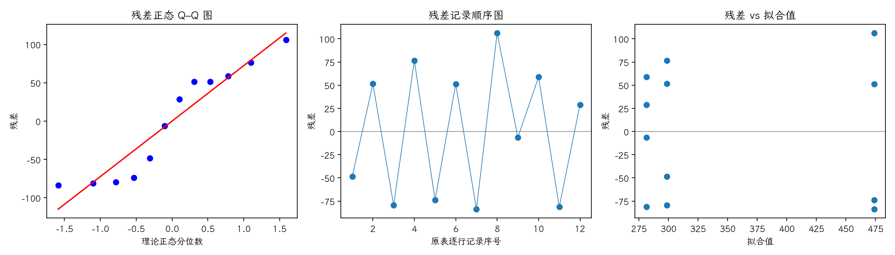

(exercise-4-59)=
# 习题 4.59：直邮试验忽略地区区组的影响

[习题与答案](../../index.md) / [第 4 章　随机区组、拉丁方与相关设计](../chapter04.md)

第 9 版 · 第 4 章 · 原书章末习题见印刷页 171～178。题目依据第 9 版，参考答案按题意匹配。

## 题目

假定习题 [4.13](./exercise-4-13.md) 以完全随机设计进行，忽略地区差异但得到完全相同的数据。重新分析，比较忽略区组对结论的影响。

| 处理／区组（4.17 为组内受试者序号） | 1 | 2 | 3 | 4 |
| --- | --- | --- | --- | --- |
| 设计1 | 250 | 350 | 219 | 375 |
| 设计2 | 400 | 525 | 390 | 580 |
| 设计3 | 275 | 340 | 200 | 310 |

## 答案与解析

**模型与假设**：$y_{ij}=\mu+\tau_i+\epsilon_{ij}$，误差独立且服从 $N(0,\sigma^2)$。$H_0$：各处理均值相等；备择为至少一个不同。

$$SS_A=\sum_i n_i(\bar y_i-\bar y)^2,\quad SS_E=\sum_{ij}(y_{ij}-\bar y_i)^2,\quad SS_T=SS_A+SS_E,\quad F_0=\frac{SS_A/(a-1)}{SS_E/(N-a)}.$$

| 来源 | 自由度 | 平方和 | 均方 | $F$ | $P$ 值 |
| --- | --- | --- | --- | --- | --- |
| 处理 | 2 | 90755.2 | 45377.6 | 7.49843 | 0.012117 |
| 误差 | 9 | 54464.5 | 6051.61 | — | — |
| 总计 | 11 | 145220 | — | — | — |

$F_0=7.49843$，$P=0.012117$，拒绝处理均值相等的原假设，有处理差异的证据。

区组模型 $MS_E=904.806$，完全随机模型 $MS_E=6051.61$；后者把地区差异并入误差。处理平方和保持不变，但误差自由度由 6 增为 9。完全随机模型的处理检验仍显著；区组化显著提高了比较精度。

残差为 $e=y-X\hat\theta$。左图检查正态性及极端残差，右图检查方差和均值结构。中图按表中逐行记录顺序绘制；题目未给出实际随机运行顺序，**它不是真实时序图，不能据此确认时间独立性**。需获得运行日志后再按实际时间重画。未见明显图形异常也不能证明假设成立。

残差 Shapiro–Wilk 统计量 $W=0.881236$、$P=0.0909013$（作为辅助描述，拟合残差相互相关，不能当成独立原始样本的精确检验）。未检出明显的正态性偏离；小样本下检验功效有限，仍应结合 Q–Q 图判断。

---

**答案来源**：无直接对应题；按第 9 版题意重新计算。

← [上一题 4.58](./exercise-4-58.md) · [本章题目目录](../chapter04.md)
